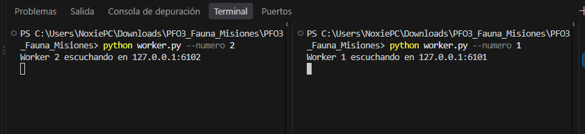
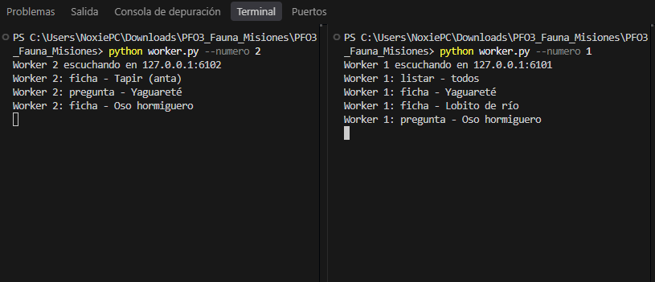
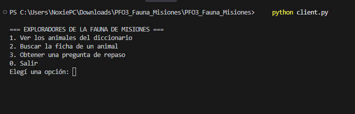
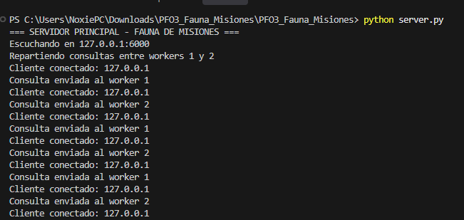
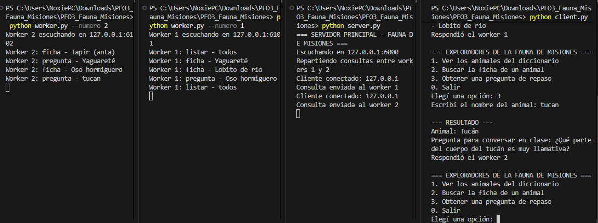
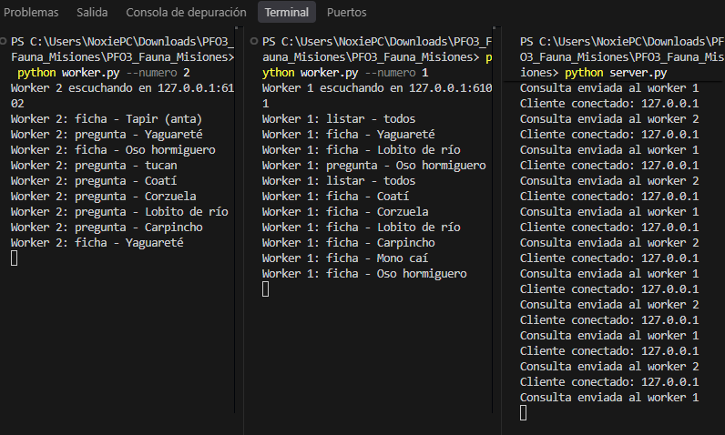
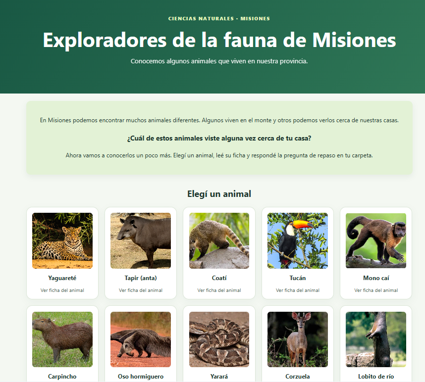

# PFO3 - Exploradores de la fauna de Misiones

## Introducción

En este tercer trabajo práctico de Programación sobre Redes desarrollé un pequeño diccionario escolar sobre la fauna de Misiones. Elegí esta temática porque se puede usar para trabajar contenidos de Ciencias Naturales.

La idea fue practicar una forma de comunicación diferente: el cliente envía una consulta al servidor principal y este la reparte entre dos servidores trabajadores (*workers*). Los workers buscan la información y devuelven la respuesta.

El proyecto utiliza Python y sockets. También incorporé una página web con Flask, HTML, CSS y JavaScript para consultar la información de forma más visual. Es una forma adicional de usar el diccionario: el cliente de consola sigue funcionando y ambos consultan al mismo servidor principal.

## ¿Qué se puede hacer?

- Ver la lista de animales disponibles.
- Buscar una ficha con el grupo, ambiente, alimentación y un dato de cada animal.
- Obtener una pregunta sencilla para repasar en clase.

El diccionario es pequeño y está pensado como ejemplo escolar, no como una enciclopedia completa.

## Archivos

- `client.py`: muestra el menú y envía consultas.
- `server.py`: recibe consultas por socket y las reparte entre dos workers.
- `worker.py`: abre un servidor trabajador y atiende pedidos con un pequeño pool de hilos.
- `animales.py`: contiene los datos del diccionario escolar.
- `web.py`: conecta la página web con el servidor principal.
- `templates/inicio.html`, `static/estilo.css` y `static/pagina.js`: forman la interfaz web.
- `requirements.txt`: indica la dependencia necesaria para usar la página web.
- `static/imagenes/`: contiene las imágenes de los animales y las capturas de las pruebas.
- `actividad_servidor.log`: se genera al iniciar y usar el servidor; registra consultas.

## Cómo ejecutarlo

Para usar el cliente de consola solo necesitás Python, sin instalar librerías externas. Para la página web también necesitás Flask; los pasos están en el apartado de la página web.

Abrí la carpeta en VS Code y utilizá **cuatro terminales** (las cuatro deben quedar abiertas durante las pruebas):

**Terminal 1 — Worker 1**

```powershell
python worker.py --numero 1
```

**Terminal 2 — Worker 2**

```powershell
python worker.py --numero 2
```

**Terminal 3 — Servidor principal**

```powershell
python server.py
```

**Terminal 4 — Cliente**

```powershell
python client.py
```

Probá primero la opción 1 para ver los animales. Después buscá, por ejemplo, `yaguareté`, `tapir` o `tucán`, y pedí una pregunta de repaso. Cada consulta muestra qué worker respondió. Para detener los servidores, presioná `Ctrl+C` en cada terminal.

## ¿Cómo funciona la distribución?

El servidor principal escucha en el puerto `6000`. Envía las consultas alternadamente al worker 1 (`6101`) y al worker 2 (`6102`). Cada worker está en un proceso distinto y atiende varios pedidos utilizando un pool de tres hilos. Si un worker no responde, el servidor intenta con el otro.

Para las conexiones usé `socket`; para los hilos, `ThreadPoolExecutor`; y para intercambiar información, `json`. También agregué tiempos de espera y mensajes de error sencillos.

## Pruebas de funcionamiento

### 1. Inicio de los workers

En esta captura se pueden ver los dos workers iniciados, cada uno escuchando en un puerto diferente y esperando las consultas que envía el servidor principal.



### 2. Workers recibiendo consultas

Después de realizar varias consultas, pude comprobar que los dos workers recibían y procesaban las solicitudes.



### 3. Inicio del cliente

Al ejecutar el cliente aparece un menú desde el cual podemos consultar los animales, buscar sus fichas y obtener preguntas de repaso.



### 4. Servidor principal

El servidor principal recibe las consultas y las distribuye entre los workers. En la terminal se puede observar a cuál de ellos envía cada solicitud.



### 5. Comunicación entre el cliente y los servidores

En esta prueba se puede ver cómo se comunican el cliente, el servidor principal y los workers para procesar una consulta y devolver el resultado.



### 6. Distribución de varias consultas

Realicé diferentes consultas sobre los animales de Misiones y pude observar cómo el servidor las repartía entre los dos workers.



### 7. Interfaz web

Además del cliente de consola, agregué una página web para consultar la información de los animales de Misiones de una forma más visual. Esta página también se comunica con el servidor principal, que distribuye las consultas entre los workers.



## Bibliografía

- Material de la cátedra **Programación sobre Redes**. Clases 10 y 11: sockets TCP, multihilos y manejo de errores.
- Material de la cátedra: arquitectura cliente-servidor y ejemplos de servidores locales en Python.

## Uso de inteligencia artificial

Para realizar este trabajo utilicé herramientas de inteligencia artificial como apoyo para desarrollar y adaptar el código, resolver algunos errores y organizar la documentación. También realicé pruebas desde la consola y la página web para comprobar el funcionamiento del sistema.

## Conclusión

En este trabajo pude ver cómo un servidor recibe solicitudes y las reparte entre otros servidores que resuelven las consultas. También practiqué el uso de sockets, hilos y mensajes en formato JSON.

## Página web en el navegador (opcional)

También agregué una página para consultar el diccionario desde Chrome, sin quitar el cliente de consola. La página se comunica con `web.py` (Flask), y este le envía la consulta por socket al **mismo servidor principal** que usa el cliente de consola. De esa manera se siguen usando los dos workers.

Primero instalá Flask (solo una vez):

```powershell
python -m pip install -r requirements.txt
```

Iniciá los dos workers y el servidor principal como explico arriba. Después abrí una **quinta terminal** y ejecutá:

```powershell
python web.py
```

Abrí en Chrome: **http://127.0.0.1:5000**

Si querés, podés abrir el cliente de consola en otra terminal al mismo tiempo. Las dos formas de consultar usan el mismo servidor principal y los mismos workers.

La página web es una mejora para mostrar el proyecto de forma más visual. Para cumplir la consigna del PFO3 mantuve también el cliente por sockets que pide el profesor. Esta página funciona **en mi computadora**, no está publicada en Internet.

